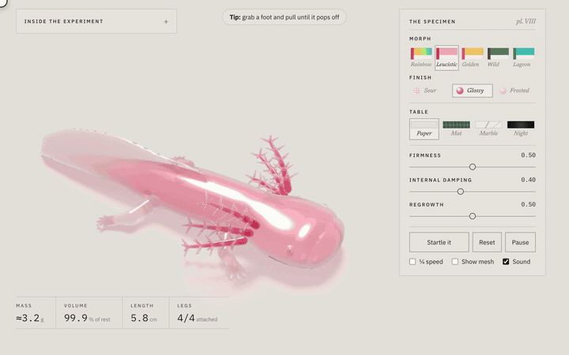

<div align="center">

# Axolotl Jelly

**A gummy axolotl you can pull apart.** Tear off a leg and it twitches on the table while a new one grows back from the stump.

[**▶ Play it live on Dream Meridian**](https://dreammeridian.com/playground/axolotl-jelly?utm_source=github&utm_medium=readme&utm_campaign=axolotl-jelly) · [Follow along on X](https://x.com/saulfloresjr) · [More in the Playground](https://dreammeridian.com/playground?utm_source=github&utm_medium=readme&utm_campaign=axolotl-jelly)



<sub>The 26-second tour: play with it, launch a leg at the camera in slow motion, watch it grow back, then every morph. Recorded silent; the real thing squishes, wobbles and boings. [Watch the MP4](media/demo.mp4).</sub>

</div>

## What you can do

- **Pull a leg off.** Grab a foot and drag. The jelly stretches with a low gummy groan, and the leg pops off with a cork and a boing. It keeps twitching on the table.
- **Watch it grow back.** A pale bud swells out of the stump and fills in with a rising hum.
- **Squish it.** Poke the head, drag the tail, throw the goo drops. Twist it with the scroll wheel or a second finger.
- **Change the candy.** Five morphs (leucistic, rainbow, golden, wild and lagoon), three finishes (glossy, sour sugar, frosted) and four tables (paper, cutting mat, marble, night).
- **Launch a leg at your face.** Turn on ¼ speed, pull a foot down toward you until it pops, and fling it: it comes flying out of the screen in slow motion.

## Run it yourself

No build step, no dependencies. Plain JavaScript and WGSL.

```bash
git clone https://github.com/saulfloresjr/axolotl-jelly.git
cd axolotl-jelly
python3 -m http.server 8000
```

Then open <http://localhost:8000> in a browser with WebGPU: current Chrome, Edge or Safari 26 and later. (It needs a local server because browsers won't run it from a `file://` path.)

## Make your own

Everything is built from code at load time, so changing the creature is changing a few functions.

| You want to… | Look in | What to change |
|---|---|---|
| Change the shape | `shape.js` | The body is a signed distance field: `CORE` sets its width and height along the spine, `FIN` the tail fin, `LEGS` the four legs. Swap in your own SDF to grow a different animal. |
| Change the colours | `main.js` | `LOOKS`: each morph is the light that survives one unit of jelly, the shadow colour, the belly and the gills. |
| Change how it wobbles | `sim.js` | `edgeCompliance` (springiness), `dampRate` (how fast wobbles die), and the tear limit in `checkTear`. |
| Change the sounds | `sound.js` | Every sound is synthesized with Web Audio: no audio files. Each one is a few lines. |
| Change the coatings | `render.js` | `fsJelly`: the sour sugar is a 3-D cell pattern of tilted crystals; frosted is a finer, flatter one. |

If you make something, tag it on X so I can see it.

## How it works

1. **A shape made of distances.** The axolotl is a signed distance function: a lofted body with a broad flat head, a fin that wraps the tail, and four legs with splayed fingers.
2. **Skins and lattices.** Surface nets turns that function into a smooth skin. Underneath, a coarse grid of cubes, each split into five tetrahedra, fills the body and each leg separately.
3. **Soft-body physics.** [XPBD](https://matthias-research.github.io/pages/publications/XPBD.pdf) keeps every edge near its rest length and every tetrahedron near its rest volume, many times a frame. The tail sways because edges along its flanks lengthen and shorten in a travelling wave.
4. **Tearing and regrowth.** Each leg is held on by "glue" links. Pull hard enough and the leg is copied into a spare slot that's glued to nothing, while a 5 % bud takes its place and has its rest lengths scaled back up to full size.
5. **Gills.** Chains of particles pulled softly toward their rest shape, so they hold their form and still flutter.
6. **Light through gel.** Four WebGPU passes a frame: a shadow map, the floor, the jelly's back faces (to measure thickness), then the front faces with Beer–Lambert absorption, refraction and Fresnel.

## Credits

- XPBD soft bodies: Macklin, Müller and Chentanez, and Matthias Müller's [Ten Minute Physics](https://matthias-research.github.io/pages/tenMinutePhysics/).
- The sour, frosted and table textures were suggested by the texture library in [CNC Kitchen's stlTexturizer](https://github.com/CNCKitchen/stlTexturizer).

## License

MIT. Use it, remix it, ship it. See [LICENSE](LICENSE).

---

<div align="center">

**[Dream Meridian](https://dreammeridian.com/?utm_source=github&utm_medium=readme&utm_campaign=axolotl-jelly)** builds creative software. Some of it ships as [products](https://dreammeridian.com/studio?utm_source=github&utm_medium=readme&utm_campaign=axolotl-jelly); some of it ends up as a gummy axolotl.
[More in the Playground](https://dreammeridian.com/playground?utm_source=github&utm_medium=readme&utm_campaign=axolotl-jelly) · [Follow along on X](https://x.com/saulfloresjr)

</div>
